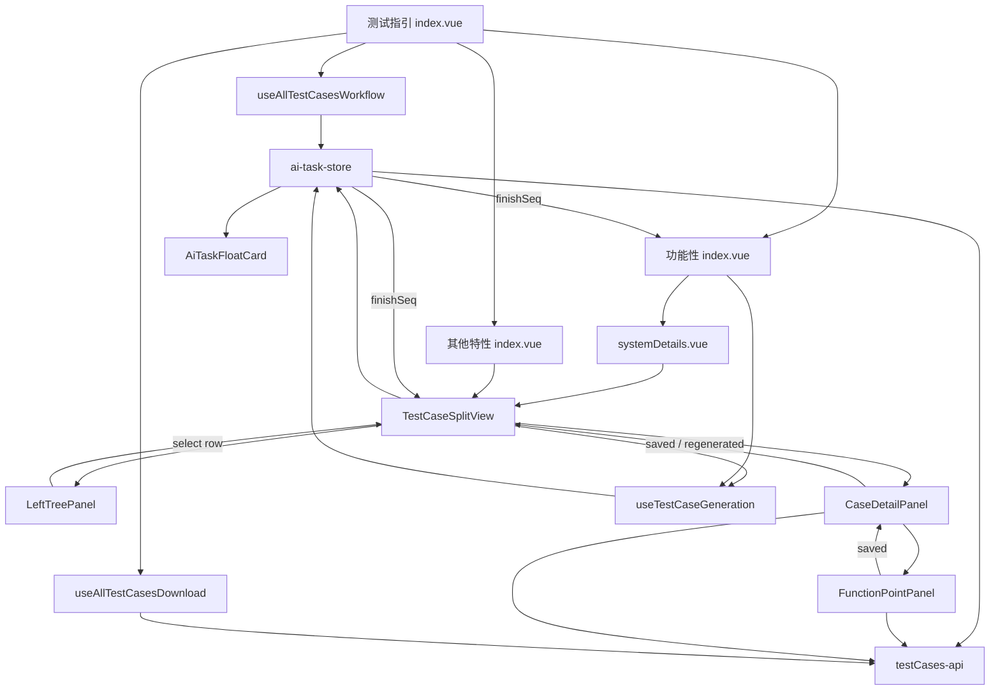

# 前端测试用例模块：逐文件逻辑与调用链

分析日期：2026-11-23。分析对象是当前工作区已经保存的源码，包含已有的本地改动；不是仅分析 Git HEAD。本文只解释前端可确认的行为，后端实际处理与菜单数据仍以服务端为准。未运行页面、调用接口或执行构建。

## 1. 模块解决什么问题

这是项目流程中的业务测试用例管理模块。它把项目的测试项组织成树，支持提取功能点、人工评审功能点、生成 AI 用例、查看详细版用例、下载 Word，以及管理异步任务进度。

主线是：

```text
进入项目流程，确定项目与权限
  → 选择特性（功能性还需选择子系统）
  → 加载测试项树，选中测试项
  → 提取功能点 → 人工编辑并保存
  → 选择详细版/常规版 → 提交生成任务
  → 全局轮询任务，完成后刷新页面
  → 查看详细版或下载对应版本 Word
```

范围、版本和执行模式是三个不同维度：

| 维度 | 字段 | 含义 |
| --- | --- | --- |
| 项目 | `subjectId` | 当前流程项目；来自项目流程上下文 |
| 批量范围 | `scope: 'allFeatures'` | 全项目九特性；普通特性与两个特殊特性分别处理 |
| 特性范围 | `feature` | `1` 功能性，`2..7` 普通非功能特性，`8` 用户文档集，`9` 性能效率 |
| 子特性 | `subFeature` | 功能性使用固定 `'1'`，其他特性页通常不限定 |
| 子系统 | `subsystem` | 不传表示未限定子系统；功能性详情传所选子系统 ID |
| 用例版本 | `caseType` | `detail` 详细版，`simple` 常规版 |
| 执行模式 | `mode` | `increment` 增量，`overwrite` 覆盖 |

详细版按功能点拆分用例，常规版按测试项合并功能点。版本选择框明确说明：页面详情展示详细版，常规版生成后下载查看。增量/覆盖的跳过与替换语义由前端确认文案及接口约定表达，真正执行在后端。

## 2. 文件总览与层次

模块目录内共 14 个文件，API 和类型各另有一个核心文件：

```text
src/views/projectProcess/testCases/
├─ testCasesFunctionality/
│  ├─ index.vue                         功能性子系统列表及全子系统操作
│  ├─ systemDetails.vue                 所选子系统的参数适配层
│  └─ testCasesFunctionality.config.ts  功能性范围和任务元信息工厂
├─ testCaseFeature/
│  ├─ index.vue                         query 驱动的其他特性入口
│  └─ testCaseFeature.config.ts         特性码与中文名映射
├─ testCaseGuidelines/
│  └─ index.vue                         四步总流程及授权特性导航
├─ components/
│  ├─ TestCaseSplitView.vue             范围、请求、批量动作的共享容器
│  ├─ LeftTreePanel.vue                 测试项树、过滤、选中
│  ├─ CaseDetailPanel.vue               当前项详情、详细版用例、单项生成
│  ├─ FunctionPointPanel.vue            功能点草稿、评审、保存、单项提取
│  └─ TestCaseVersionDialog.vue         详细版/常规版选择与事件回传
├─ useTestCaseGeneration.ts             普通特性范围生成流程
├─ useAllTestCasesWorkflow.ts           项目级全特性提取/生成流程
└─ useAllTestCasesDownload.ts           项目级九特性下载流程

src/api/projectProcess/testCases-api.ts  HTTP 接口适配
src/types/projectProcess/testCases.d.ts  请求、响应、领域对象的类型约定
```



## 3. 页面与配置：6 个文件

### 3.1 `testCasesFunctionality/index.vue`

源码：[功能性首页](D:/project/rebuild_project/src/views/projectProcess/testCases/testCasesFunctionality/index.vue:32)。

**职责**：功能性测试用例的第一层入口。先展示子系统树，进入子系统后显示该子系统测试项；同时提供全部功能性子系统范围的提取、生成、下载。

逻辑构造：

1. **依赖与状态**：初始化 `useTestCaseGeneration`，范围固定 `feature='1', subFeature='1'`；保存资源页 ref、当前子系统 `currentSystem`、提取/下载 pending、两个版本弹窗状态。
2. **列表定义**：搜索项只有 `name`，表格列为名称、未完成数量。`fetchData` 调 `getTestCaseFnSystemListAPI`，底层资源是 `/ras/subsystem/list`。
3. **页面切换**：`openSystem(row)` 记录 `{id,name}`。外层列表用 `v-show` 隐藏并保留状态，内层 `SystemDetails` 用 `v-if` 创建；返回时清空 `currentSystem` 并销毁内层实例。
4. **提取**：`handleExtractFunctionPoints(mode)` 先检查全局忙碌和清理状态，再确认增量/覆盖行为；捕获当前项目，获取详情并核对仍属于原项目、组件未卸载，最后 `aiTaskStore.start(...,'extract')`。
5. **生成**：选择版本后 `generation.generate({caseType, mode:'increment'})`，提交与异步保护集中在 hook。
6. **下载**：`handleDownloadTestCases` 下载当前项目全部功能性子系统的指定版本；下载版本框额外允许 `all`，交给 `useAllTestCasesDownload` 下载九特性详细版。
7. **配置驱动渲染**：`pageConfig` 声明工具栏和行操作；按钮文案、禁用状态用 getter 读取最新任务状态。`ScResourcePage` 承担列表获取、搜索、刷新、树渲染。
8. **任务联动**：监听 `finishSeq`，若任务属于当前项目则刷新子系统树；挂载时 `generation.resume()` 恢复任务。

关键位置：范围 34 行；完成后刷新 39 行；搜索/列 51 行；选系统 60 行；提取 82 行；下载 127 行；配置 178 行；模板 266 行。

注意：子系统行的“操作”按钮条件是 `!!row.child && row.child.length === 0`，要求存在空 `child` 数组。这里的叶子判断与测试项树依赖 `titleFlag` 的判断不同。列表不分页。

### 3.2 `testCasesFunctionality/systemDetails.vue`

源码：[子系统详情适配层](D:/project/rebuild_project/src/views/projectProcess/testCases/testCasesFunctionality/systemDetails.vue:5)。

**职责**：把功能性首页选中的子系统适配成共享组件的参数，没有独立的数据请求和生成算法。

- 输入：`systemId`、`systemName`。
- 渲染 `TestCaseSplitView`：固定 `feature='1'`、`subFeature='1'`，传入 `subsystem={id,name}`。
- 开启 `showBack`，将子组件的 `back` 事件向功能性首页转发。

这个文件薄是有意的：功能性与其他特性共享同一个详情实现，不复制树和 AI 逻辑。

### 3.3 `testCasesFunctionality/testCasesFunctionality.config.ts`

源码：[功能性范围配置](D:/project/rebuild_project/src/views/projectProcess/testCases/testCasesFunctionality/testCasesFunctionality.config.ts:4)。

**职责**：集中定义功能性范围和全局任务所需的展示、下载元信息。

- `TEST_CASE_FN_SCOPE`：`{feature:'1',subFeature:'1'}`。
- `createTestCaseFnTaskMeta(project, system?, caseType='detail')`：生成 `subjectId`、任务卡范围文案 `scopeLabel`、下载参数 `downloadParams`、Word 文件名 `fileName`。
- 传 `system` 表示某子系统，不传表示全部子系统；版本影响参数、文案和文件名。

它是参数工厂，不调接口、不存页面状态。提取任务实际不提供下载，store 在规范化任务元信息时会将提取任务的下载参数置空。

### 3.4 `testCaseFeature/index.vue`

源码：[其他特性入口](D:/project/rebuild_project/src/views/projectProcess/testCases/testCaseFeature/index.vue:8)。

**职责**：把路由 query 转为共享详情组件的特性参数。

1. 读取 `route.query.feature`，数组取第一项，缺失取空串。
2. 从配置映射获得 `featureName`。
3. 有效则渲染 `TestCaseSplitView(feature,featureName)`；无效显示空状态。
4. `:key='feature'` 使切换特性时重建共享组件，隔离上一个特性的选中项和组件状态。

这里没有子系统中间页，也没有传入 `subFeature` 或 `subsystem`，因此按整特性查询。文件注释仍写“六个特性、2..7”，实际支持映射中的 `2..9`。

### 3.5 `testCaseFeature/testCaseFeature.config.ts`

源码：[特性名称映射](D:/project/rebuild_project/src/views/projectProcess/testCases/testCaseFeature/testCaseFeature.config.ts:6)。

**职责**：将特性码 `2..9` 映射为中文名称，供入口校验、标题和操作文案使用。

| 码 | 名称 | 共享容器中的处理 |
| --- | --- | --- |
| 2 | 信息安全性 | 普通功能点提取、生成、下载 |
| 3 | 兼容性 | 同上 |
| 4 | 可靠性 | 同上 |
| 5 | 易用性 | 同上 |
| 6 | 可移植性 | 同上 |
| 7 | 维护性 | 同上 |
| 8 | 用户文档集 | 整特性步骤生成与专用文档下载 |
| 9 | 性能效率 | 展示与下载，页面没有 AI 提取/生成按钮 |

映射表只负责名称，真正的分支判断位于 `TestCaseSplitView`。

### 3.6 `testCaseGuidelines/index.vue`

源码：[测试指引](D:/project/rebuild_project/src/views/projectProcess/testCases/testCaseGuidelines/index.vue:15)。

**职责**：全模块的项目级工作流入口，组合四步操作与已授权特性页面导航。

- 本地状态：特性选择弹窗、选中路由名、生成版本弹窗、下载版本弹窗。
- `steps` 是 computed，依次描述“查看与完善 → 提取功能点 → 生成用例 → 下载全部用例”。第二、三步调用 `useAllTestCasesWorkflow`，第四步调用 `useAllTestCasesDownload`。
- 生成按钮受全特性提取完成资格约束；下载错误以告警展示，并可转到特性页。
- `subFeatureOptions` 递归扫描当前项目授权侧栏菜单，按组件路径和 query.feature 匹配九特性；必须有 route name 且 `router.hasRoute(name)` 才提供选择。
- `handleRoutePage` 按真实路由名导航，保留项目等 query，先清旧 feature，再合入目标菜单的 feature。
- 模板用 `StepGuide` 渲染步骤，复用两个版本选择框和特性选择框。

因此指引页同时承担总操作与导航。它没有硬编码某个部署环境的页面 URL，也没有在前端循环调用九次生成接口。

关键位置：四步配置 20 行；授权路由扫描 79 行；跳转 120 行；模板 139 行。

## 4. 共享组件：5 个文件

### 4.1 `components/TestCaseSplitView.vue`

源码：[共享容器](D:/project/rebuild_project/src/views/projectProcess/testCases/components/TestCaseSplitView.vue:34)。这是建议重点阅读的第一个文件。

**职责**：范围编排、数据获取、批量动作、下载以及左右面板连接。它并不直接实现功能点编辑。

**输入输出**：props 为 `feature/featureName/subFeature/subsystem/showBack`；只向外 emit `back`。

**状态与派生数据**：

- `scopeParams`：统一接口范围参数。
- `scopeName`：子系统名或特性名。
- `isDocSet/isPerformance`：识别特性 8/9。
- `treeRows/dynamicData/currentRow/loading`：测试项树、动态附件字段、选中项、加载状态。
- `docSetRecord` 相关状态：整特性用户文档集核查步骤。
- 任务与弹窗状态：提取提交、生成模式、版本框、下载中。

**数据加载**：`fetchTreeData()` 调 `getTestCaseFnItemListAPI`，固定 `dataType:'2'` 并加当前范围，将 `data.result.rows` 和 `data.files` 分别存入树及动态字段。参数包含页码，但源码约定此处接口不分页，实际左树是全量数据与前端过滤。`fetchDocSetStep()` 仅在文档集分支查询项目级步骤记录。

**动作入口**：

1. `handleExtractAll(mode)`：增量/强制重提；确认前后核对项目和范围，提交全局 `'extract'` 任务。
2. `handleGenerateDocSet()`：文档集专用，提交 `'docset'` 任务。
3. 普通生成：`useTestCaseGeneration` 接收当前普通特性范围；`beforeGenerate` 调右侧详情的 `ensureSaved()`，保存功能点草稿后才能提交。
4. `openGenerate(mode)` 先记录 increment/overwrite，再开版本框；`pickGenerate(caseType)` 将选择的版本与模式传给生成 hook。
5. 下载：普通特性先选版本；文档集和性能效率直接按详细版范围下载。接口返回后调用 `downloadFile`。
6. `FLAT_BUTTONS` 声明按钮，`flatButtons` 按权限、任务状态、特性分支计算显示/禁用和进度文字，统一点击分发。

**父子联动**：

- `LeftTreePanel @select` → 设置 `currentRow`。
- `currentRow` + `dynamicData` → `CaseDetailPanel`。
- 详情 `saved/regenerated` → 重查树；详情公开方法用于保存检查和功能点刷新。
- 任务完成 `finishSeq` → 同项目时重查树、功能点、文档集步骤。
- 挂载时取数据并恢复全局任务；卸载会使待提交操作的上下文失效，但不会停止已交给全局 store 的任务。

**特性分支**：普通 `1..7` 展示提取/重提/生成/重生/下载；`8` 展示文档集生成/下载并附整特性步骤卡；`9` 主要展示下载。8/9 给详情传 `hideAiActions`，隐藏行级 AI 操作与功能点编辑面板。

关键位置：范围与分支 57 行；取树 97 行；提取 140 行；文档集生成 195 行；普通生成 hook 219 行；下载 243 行；按钮配置 275 行；任务完成刷新 404 行；模板 433 行。

### 4.2 `components/LeftTreePanel.vue`

源码：[左树导航](D:/project/rebuild_project/src/views/projectProcess/testCases/components/LeftTreePanel.vue:8)。

**职责**：接收树、过滤树、维护选中高亮、向父级报告当前项。没有 API 请求。

- props：`rows/loading`；emit：`select(row|null)`。
- `isLeafRow` 用 `String(titleFlag) !== '1'` 判断业务测试项。
- `findFirstLeaf/findRowById` 递归寻找首项或原选中项。
- rows 更新后 `syncSelectionAfterFetch` 等待 DOM，优先按 id 保留选择，找不到再选首个测试项；设置高亮后主动 emit。空树清选中并 emit null。
- `filterText` 变化时调用 `el-tree.filter`；过滤依据是编号与名称拼接后的文本。
- 点击分类节点也 emit，右侧根据 `titleFlag` 显示相应空态。
- `enable='0'` 仅改变样式为灰色/删除线，不从树删除该行。
- 树以 `id` 为 key，子级字段为 `child`，默认展开；面板宽 280px 并独立滚动。

没有后端搜索、分页、拖拽和行编辑。

### 4.3 `components/CaseDetailPanel.vue`

源码：[右侧详情](D:/project/rebuild_project/src/views/projectProcess/testCases/components/CaseDetailPanel.vue:24)。

**职责**：将当前测试项及其详细版 AI 结果组织成可阅读内容，嵌入功能点编辑器，提供单项同步生成。

**输入输出**：props `row/dynamicColumns/hideAiActions`；emit `regenerated/saved`。只有业务叶子才显示详情。

**显示逻辑**：

- 选中 id 变化时收起更多详情并滚到顶部；同一项重新拉取时保留阅读位置。
- 查询 `sub_property` 字典，把子特性码转为名称；没有映射时回退原码。
- `detailFields` 拼接说明、备注、测试结果/结论、AI 依据、动态附件字段等。
- `effectiveCases` 优先取 `row.aiExpansion.cases`；旧版扁平 AI 数据包装成单个用例；没有 AI 内容时前提与步骤回退原始 row。
- 每条用例展示名称、优先级、需求、前提、步骤、测试数据。数据表为编号/输入/预期，不分页，也不提供直接编辑生成结果的入口。

**单项生成**：`regenerateCurrent()` 先 `FunctionPointPanel.ensureSaved()`，并核对保存期间未切项；调用 `regenerateAiTestCaseAPI({resultIds:[row.id]})`。首项缺失或 status=3 提示失败，status=2 提示原文降级回填，其他提示完成；随后 emit `regenerated` 让容器更新树。

**向上公开**：`refreshFunctionPoints` 和 `ensureSaved`，实际转调下层功能点组件。下层 `saved` 向父级转发。

关键位置：详情字段 88 行；兼容新旧用例 119 行；单项生成 159 行；公开方法 189 行；模板 195 行。

### 4.4 `components/FunctionPointPanel.vue`

源码：[功能点评审编辑器](D:/project/rebuild_project/src/views/projectProcess/testCases/components/FunctionPointPanel.vue:14)。这是建议重点阅读的第二个文件。

**职责**：管理一个测试项的功能点提取、有效/剔除清单、人工编辑草稿、保存，以及生成前保存检查。

**数据结构与状态**：

- props `resultId/itemName/itemNumber`；emit `saved`。
- `ReviewPoint = AiFunctionPoint & {localKey:number}`，为本地新增项保留稳定渲染 key。
- `fpPoints` 是当前草稿，`savedPoints/savedResultId` 是已保存快照，`fpDirty` 标记是否有未保存编辑。
- `fpLoading/fpExtracting/fpSaving` 汇总成忙碌状态，避免处理中继续编辑。
- `contextVersion/requestVersion/extractionVersion` 让切项、卸载或后发请求使旧异步响应失效。
- `saveQueue/pendingSaves` 串行保存，避免多个整表写入相互覆盖。
- `pointType='1'` 进入有效区，`'0'` 进入剔除区。

**加载**：watch resultId，立即查询 `getFunctionPointsAPI(resultId)`；响应必须匹配当前上下文、请求版本和测试项才写回。请求失败时不会假装清单已加载成功。

**草稿编辑**：添加、改名称/描述、剔除、恢复、删除都先改本地数组并设 dirty；统一通过保存发送。剔除会设置 `pointType='0'`、status='2' 并补原因，恢复则清原因并置回有效状态。没有自动保存或拖拽排序。

**`persist()`**：

1. 捕获已加载 resultId 与上下文，检查仍是当前项。
2. 将保存操作加入 `saveQueue`。
3. 检查所有名称非空。
4. 提交 `{resultId, expectedIds, items}`；`expectedIds` 来自服务端旧快照，用于完整清单冲突校验。
5. 成功采用服务端返回清单、清 dirty、emit saved；失败保留草稿并提示。

**`ensureSaved()`**：等待保存队列；核对仍是当前项；忙碌或未成功加载返回 false；有草稿就确认“保存并生成”，取消或保存失败均返回 false。上层据此阻止生成。

**两种刷新语义**：`refresh()` 供任务完成后自动刷新，有草稿就保留并提示；`reloadCurrent()` 是用户手动刷新，有草稿需确认放弃。不能把二者当成同一个动作。

**单项提取**：`extractCurrent()` 确认覆盖清单/人工编辑及使已有用例失效后，调用同步 `extractFunctionPointsSyncAPI({resultIds:[id]})`；成功重读清单并 emit saved，失败在面板展示错误。

**对外公开**：`refresh/ensureSaved`，经详情组件向容器提供能力。

关键位置：状态 24 行；取清单 63 行；resultId watcher 115 行；保存 128 行；生成前检查 186 行；刷新 218 行；同步提取 248 行；草稿动作 290 行；模板 335 行。

### 4.5 `components/TestCaseVersionDialog.vue`

源码：[版本选择框](D:/project/rebuild_project/src/views/projectProcess/testCases/components/TestCaseVersionDialog.vue:5)。

**职责**：只呈现版本选择并回传事件，不提交生成或下载请求。

- `defineModel<boolean>` 管开关；props `title/action/disabled/allowAll/contextKey` 定制文案与选项。
- 选择详细版或常规版时先关闭，再 emit `select(caseType)`。
- `allowAll && action==='download'` 时提供九特性详细版选项，emit `all`。
- watch `[route.fullPath, contextKey]`，页面或操作范围变化时同步关闭旧弹窗，避免旧选择作用于新范围。
- 用文案解释两版本区别及页面只显示详细版的约定。

## 5. 流程 hooks：3 个文件

### 5.1 `useTestCaseGeneration.ts`

源码：[范围生成流程](D:/project/rebuild_project/src/views/projectProcess/testCases/useTestCaseGeneration.ts:21)。这是建议重点阅读的第三个文件。

**职责**：统一普通特性 `1..7` 的生成流程，供功能性首页与共享容器使用；轮询由全局 store 负责。

**辅助类型/函数**：

- `CaseType`：detail/simple。
- `GenerateMode`：increment/overwrite。
- `GenerationScope/GenerationContext`：范围与本次生成上下文。
- `isStandardFeature`：限制普通特性。
- `generationScopeParams/generationScopeName`：统一接口范围与文案。
- `createGenerationTaskMeta`：统一任务卡信息、下载范围、文件名。

**返回状态**：`pending/disabled/buttonText/matchesCurrentScope/generate/resume`。disabled 合并提交状态、全局忙碌、清理等待、范围有效性与生成权限。

**`generate({caseType,mode})` 的顺序**：

1. 拦截禁用/卸载，锁 pending。
2. 克隆范围，捕获项目、路由、revision 与范围快照。
3. 校验特性/版本/模式，获取并核对项目详情。
4. 调调用方可选 `beforeGenerate`，用于保存当前功能点草稿。
5. 确认增量/覆盖及对应版本。
6. 再核对原项目/路由/范围、权限、全局忙碌与清理状态。
7. 再次 `beforeGenerate`，防止确认期间又产生编辑。
8. `store.start(params,meta)`，返回 submitted/cancelled/blocked/failed。
9. finally 解锁；已被请求层处理的业务错误避免重复弹窗。

`watch(route.fullPath,scope)` 与 `onScopeDispose` 共同使过期操作失效。`resume()` 根据当前项目请求全局恢复。

### 5.2 `useAllTestCasesWorkflow.ts`

源码：[项目级总流程](D:/project/rebuild_project/src/views/projectProcess/testCases/useAllTestCasesWorkflow.ts:14)。

**职责**：为测试指引提供项目全部特性的提取与生成。发一个项目级请求，由服务端编排。

- 状态：`pending` 记录 extract/generate，`restoring` 记录资格恢复中。
- `extractionComplete` 来自 `store.allFeaturesExtracted[subjectId]`；由服务端进度响应同步，不由前端简单数完成项。
- `disabled` 汇总恢复中、本地提交、全局任务、清理等待、项目与权限；`generationDisabled` 再要求全特性提取完成。
- `buttonText(kind)` 仅当任务项目、scope、taskType 均匹配时显示处理数量。
- `submit(kind,caseType)` 捕获项目/revision，取详情、确认，再核对上下文、权限与资格，最终 `store.start({subjectId,scope:'allFeatures',mode:'increment',caseType?},meta,kind)`。
- 提取任务不提供文档下载参数；生成任务绑定所选版本和全部特性范围。
- 挂载和 projectId query 变化时 `restore()` 调 store.resume，刷新提取资格；卸载使待提交动作失效。

当前总流程固定增量模式，没有在前端逐个子系统、逐个特性循环请求。

### 5.3 `useAllTestCasesDownload.ts`

源码：[九特性下载](D:/project/rebuild_project/src/views/projectProcess/testCases/useAllTestCasesDownload.ts:15)。

**职责**：统一项目级九特性 Word 下载，供测试指引和功能性首页使用。

1. 用 `downloadingAll` 防重复提交，清上次错误。
2. 点击时绑定 `subjectId`；读取项目详情并确认对应点击时项目。
3. 调下载接口 `{subjectId,scope:'allFeatures',caseType}`，默认详细版。
4. 检查响应 data 是非空 Blob，再按项目 code、版本拼文件名交 `downloadFile`。
5. 失败优先取接口 msg/message；错误数据是 Blob 时尝试解析 JSON 获取业务错误。
6. 只有用户仍在原项目时才把错误写到当前界面；切项目会清显示错误。

它没有先查询各特性、下载多个文件再前端拼 Word，而是直接请求服务端合并文档。

## 6. API 与领域类型：2 个文件

### 6.1 `src/api/projectProcess/testCases-api.ts`

源码：[接口层](D:/project/rebuild_project/src/api/projectProcess/testCases-api.ts:21)。

**职责**：声明路径、HTTP 方法、参数与响应类型、下载模式、同步长请求超时。它不持有组件状态。

除子系统接口外，下表路径均相对于 `/asset/acceptance/result`：

| 导出函数 | 方法与路径 | 调用角色 |
| --- | --- | --- |
| `getTestCaseFnSystemListAPI` | GET `/ras/subsystem/list` | 功能性首页子系统树 |
| `getTestCaseFnItemListAPI` | GET `/list` | 共享容器测试项树 |
| `regenerateAiTestCaseAPI` | POST `/aiTestCase/regenerate` | 右侧单项同步生成 |
| `generateAiTestCaseAPI` | POST `/aiTestCase/generate` | 全局 store 启动异步生成 |
| `getAiTestCaseProgressAPI` | GET `/aiTestCase/progress` | 全局 store 轮询与恢复 |
| `getFunctionPointFailuresAPI` | GET `/aiTestCase/failures` | 提取失败快照弹窗 |
| `stopAiTestCaseAPI` | POST `/aiTestCase/stop` | 全局任务停止/清理 |
| `generateDocSetAPI` | POST `/aiTestCase/generateDocSet` | 文档集步骤生成 |
| `getDocSetAPI` | GET `/aiTestCase/docSet` | 文档集步骤读取 |
| `downloadAiTestCaseAPI` | GET `/aiTestCase/download` | 各范围 Word 下载 |
| `extractFunctionPointsAPI` | POST `/aiTestCase/extractFunctionPoints` | 全局 store 异步提取 |
| `extractFunctionPointsSyncAPI` | POST `/aiTestCase/functionPoints/extractSync` | 功能点面板单项同步提取 |
| `getFunctionPointsAPI` | GET `/aiTestCase/functionPoints` | 当前项功能点清单 |
| `saveFunctionPointsAPI` | PUT `/aiTestCase/functionPoints` | 完整功能点清单评审保存 |

同步生成和同步提取按 `aiSyncTimeout(count)` 设置长超时：数量约束到 1..10 后，每项按 20 分钟计算。这是前端等待上限配置，不能据此断言服务端本次一定重试多少次。异步启动、进度、停止、下载等接口使用显式 subjectId，设置 `needSubjectId:false`，避免请求层用当前项目覆盖已绑定的任务归属。

项目归属还有一层容易漏读的逻辑：[请求拦截器](D:/project/rebuild_project/src/utils/request/interceptors.ts:12) 默认向 GET 参数或普通请求体注入当前流程的 `subjectId`；普通对象中同名字段会被当前项目值覆盖。子系统/测试项查询、单项同步生成/提取、功能点查询/保存依赖这层默认注入；全局异步任务相关接口关闭注入，确保切换页面或项目后仍使用任务绑定的原项目。

### 6.2 `src/types/projectProcess/testCases.d.ts`

源码：[领域与接口类型](D:/project/rebuild_project/src/types/projectProcess/testCases.d.ts:5)。

**职责**：定义模块共同理解的数据结构，只有类型声明，没有运行时业务操作。

| 类型组 | 内容与作用 |
| --- | --- |
| `TestCaseFnSystemSearchParams/TestCaseFnSystemData` | 子系统搜索、名称、未完成数、子树 |
| `TestCaseFnItemSearchParams/TestCaseFnItemResult` | 测试项搜索及树节点；原始说明、步骤、测试记录、动态字段、aiExpansion |
| `TestCaseFnItemListResponse` | 测试项 result.rows 与动态附件字段 files |
| `TestCaseAiDataRow/TestCaseAiCase/TestCaseAiExpansion` | 输入/预期数据行、按功能点的用例、AI 扩写结果；兼容旧扁平结构 |
| `TestCaseAiRegenerateParams/Item` | 单项或小批量 resultIds 与每项结果状态 |
| `TestCaseAiGenerateParams` | 项目、范围、模式、版本 |
| `TestCaseAiDocSetGenerateParams/Record` | 文档集任务输入与整特性步骤记录 |
| `TestCaseAiTaskProgress` | taskId、归属范围、状态、进度、计数、失败数、清理等待、全特性提取资格 |
| `FunctionPointTaskFailure/Query/Page` | 绑定项目与任务的失败明细分页快照 |
| `AiFunctionPoint/AiFunctionPointReviewParams` | 功能点、剔除原因、状态、顺序、expectedIds 与完整保存清单 |
| `TestCaseAiDownloadParams` | 项目、范围、用例版本 |

重要结构：`TestCaseFnItemResult → child[]` 表示树；`TestCaseFnItemResult → aiExpansion → cases[] → dataRows[]` 表示详细版用例内容。功能点清单通过 resultId 单独查询，不等同于 aiExpansion.cases。

## 7. 目录外的关键运行文件

### 7.1 `src/store/modules/ai-task-store.ts`

源码：[全局 AI 任务状态](D:/project/rebuild_project/src/store/modules/ai-task-store.ts:196)。它是整个批量任务链路的中心。

**状态**：`meta` 任务归属/范围/下载信息，`progress` 服务端进度，`cardVisible`，`finishSeq` 完成序号，`lostConnection`，`downloading`，`allFeaturesExtracted` 项目资格表；内部维护 timer、连续失败次数、生命周期版本、提交/停止锁。

**方法**：

- `start(params,meta,kind)`：拒绝提交/停止中、运行中或 cleanupPending 的新任务；kind 分流到生成、提取或文档集接口；规范化任务元信息；运行中启动轮询，已经终态则通知完成。
- `poll()`：请求完成后再用 setTimeout 排下一次，间隔 2000ms，避免慢接口造成并发轮询。按 lifecycle 与项目过滤旧响应，running 继续，其他状态结束并递增 finishSeq。轮询中收到 idle 会以前端失败提示任务记录丢失。
- 连续 5 次进度查询失败后停止轮询，标记失联；并不据此认定后台任务已取消。
- `resume(subjectId)`：向服务端探测恢复。另一个项目仍有活动任务时只读新项目提取资格，不替换正在追踪的任务。对已知晓的终态不重复弹卡。
- `retry()`：失联后重启进度轮询。
- `stop()`：调用停止接口；根据返回继续等收尾或通知完成。前端文案明确停止会作废本批内容，不是支持从原位置续跑的暂停。
- `download()`：使用任务自身已绑定的下载范围与版本；范围不足时要求回原页面选择版本。
- `closeCard()`：运行中通常只收起卡片；终态登记已知晓并清理任务状态，失联关闭不登记终态知晓。

**持久化**：Pinia persist 只将 meta 存到 sessionStorage（500 行），刷新后再查服务端恢复进度。额外的任务标签和终态已知晓登记存 localStorage。不要把持久化 meta 理解为进度也完整持久化。

**`resolveAiTaskMeta`**：优先信任务快照/本次提交参数恢复范围、版本与下载信息；不会依据当前页面猜测旧任务范围。提取任务没有版本下载语义。

这是当前前端 store 实例追踪一个活动任务的设计；不能仅凭前端实现推断服务端在所有用户、所有浏览器中也只允许一个任务。

### 7.2 `src/components/AiTaskFloatCard/index.vue`

源码：[全局任务浮卡](D:/project/rebuild_project/src/components/AiTaskFloatCard/index.vue:1)。

**职责**：将 store 状态转为全局任务 UI，展示范围、处理进度、成功/降级/失败统计、失联与清理提示，提供停止、轮询重试、下载、收起等操作，并在提取失败时打开任务失败快照。

它挂在布局组件而非某个测试用例页，所以用户切换菜单时任务监控仍存在。具体业务请求和定时器仍由 store 承担。

逻辑分为：订阅 store 与冻结失败查询上下文（8 行）、把进度映射为 running/lost/failed/stopped/done 五种显示阶段并计算标题颜色（25 行）、判断下载入口资格（71 行）、挂载恢复任务（81 行）、模板按阶段展示操作（88 行）。下载要求非提取任务、有可信下载参数、已完成且 total>0，并有下载权限；提取失败明细入口要求失败数>0、taskId 存在且有生成权限。失联“重试”恢复轮询，“重试作废”重新请求停止清理，均不会重新生成失败项。

### 7.3 `src/components/AiTaskFloatCard/FunctionPointFailuresDialog.vue`

源码：[提取失败快照](D:/project/rebuild_project/src/components/AiTaskFloatCard/FunctionPointFailuresDialog.vue:1)。

**职责**：分页查询指定项目、指定 taskId 的功能点提取失败项。输入是任务归属快照，内部管理查询、分页、加载和错误，打开后加载，可搜索/刷新。

`load()`（31 行）绑定本次项目与 taskId 发请求，再以 revision、visible 和项目/任务一致性接纳响应；返回 taskId 不符会提示重新打开。`submitSearch/changePage/changeSize`（67 行）管理关键词与分页；watch 打开/任务变化重置查询，路由变化关闭弹窗，卸载递增 revision 使旧响应失效（81 行）。界面列出编号、名称与 ID、所属范围、失败原因，每页可选 20/50/100 条。

此处展示的是任务失败记录，没有实现直接修复、重试提取或跳转到测试项的按钮。文案提示处理原因后回页面继续普通提取，不应将“刷新失败列表”解释成“重试 AI 任务”。

### 7.4 路由、项目、通用 UI 支撑文件

| 文件 | 与模块的连接 |
| --- | --- |
| [useProjectProcessScope.ts](D:/project/rebuild_project/src/hooks/useProjectProcessScope.ts:40) | 进入/切换项目时确定 projectId、写流程项目键、准备详情与权限、拉项目菜单 |
| [router-store.ts](D:/project/rebuild_project/src/store/modules/router-store.ts:174) | `/getRouters` 拉项目菜单，按后端 component 路径动态加载 views 并挂到 projectProcess |
| [routeQuery.ts](D:/project/rebuild_project/src/utils/routeQuery.ts:5) | 从菜单 component 字符串拆出路径及 feature 等 query |
| [SidebarMenuItem.vue](D:/project/rebuild_project/src/layout/components/SidebarMenuItem.vue:72) | 把菜单 query 带到实际导航，使共用特性页拿到 feature |
| [processProject.ts](D:/project/rebuild_project/src/utils/processProject.ts:41) | 当前流程项目详情的缓存读取与查询，减少重复请求 |
| [globalVariables.ts](D:/project/rebuild_project/src/constant/globalVariables.ts:6) | 定义项目 id/详情等上下文键 |
| [layout/index.vue](D:/project/rebuild_project/src/layout/index.vue:20) | 全局挂载 AiTaskFloatCard |
| [ScResourcePage/index.vue](D:/project/rebuild_project/src/components/ScBaseComponents/ScResourcePage/index.vue:30) | 功能性首页的通用列表、搜索、刷新和配置驱动页面 |
| [OperateButtonGroup.vue](D:/project/rebuild_project/src/views/projectProcess/components/OperateButtonGroup.vue:1) | 共享容器的扁平按钮及权限驱动渲染 |
| [StepGuide/index.vue](D:/project/rebuild_project/src/views/projectProcess/components/StepGuide/index.vue:1) | 测试指引四步的展示与操作承载 |
| [file.ts](D:/project/rebuild_project/src/utils/file.ts:1) | 下载响应保存为浏览器文件 |
| [request/interceptors.ts](D:/project/rebuild_project/src/utils/request/interceptors.ts:12) | 注入 token 与默认项目归属；任务接口以 needSubjectId:false 保留显式归属 |
| [usePermission.ts](D:/project/rebuild_project/src/components/ScBaseComponents/ScResourcePage/hooks/usePermission.ts:5) | 按当前权限集决定生成、下载等按钮能力 |
| [useScConfirmDialog.ts](D:/project/rebuild_project/src/hooks/useScConfirmDialog.ts:1) | 提供生成、覆盖、放弃草稿等确认交互 |

动态路由只能证明代码具备对应加载逻辑；未运行接口核验，不能保证某一账号或环境当前拥有全部九个菜单。

## 8. 五条完整调用链

### 8.1 进入并查看一个测试项

```text
项目流程上下文写入项目 ID
→ 菜单动态路由进入功能性/其他特性页面
→ 功能性选择子系统后由 systemDetails 转交共享容器
→ TestCaseSplitView.fetchTreeData()
→ getTestCaseFnItemListAPI → result.rows / files
→ LeftTreePanel 按原 id 恢复选择或选择首个测试项
→ emit select → currentRow
→ CaseDetailPanel 渲染原始详情及 aiExpansion.cases
→ FunctionPointPanel watch(resultId) 单独查询功能点
```

### 8.2 修改功能点再生成

```text
编辑名称/描述、添加/剔除/恢复/删除
→ fpDirty=true，仅本地草稿
→ 保存或点击生成
→ ensureSaved → 必要时确认保存
→ persist → saveQueue → saveFunctionPointsAPI(expectedIds,items)
→ saved → 详情转发 → 共享容器重查树
→ 生成 hook 再核对项目/范围并确认
→ aiTaskStore.start → 异步生成
```

### 8.3 批量任务与刷新恢复

```text
页面/hook提交范围+模式+版本
→ store.start → API 启动任务
→ store.meta/progress 更新 → 全局浮卡显示
→ 2秒串行轮询进度
→ 终态 → finishSeq++
→ 当前项目的功能性列表/共享容器响应刷新

切菜单：store及布局浮卡仍存在，轮询继续
刷新浏览器：从session meta或当前项目向服务端探测后恢复
```

### 8.4 单项同步生成

```text
CaseDetailPanel 点击生成/重新生成
→ 功能点 ensureSaved
→ regenerateAiTestCaseAPI(resultIds:[当前项])
→ 等同步结果，识别成功/原文降级/失败
→ emit regenerated
→ TestCaseSplitView 重查树
```

此链没有交给全局批量任务 store，不会通过全局轮询驱动本次单项完成。

### 8.5 九特性文档下载

```text
指引选择版本 或 功能性首页选择全部详细版
→ useAllTestCasesDownload
→ 捕获项目并校验项目详情
→ downloadAiTestCaseAPI(scope:allFeatures,caseType)
→ 检查非空 Blob
→ downloadFile 保存一个合并 Word
```

## 9. 阅读时最容易混淆的边界

1. 功能点草稿、已保存功能点和 AI 用例是三个不同层次；编辑功能点不会在前端立刻重写 aiExpansion。
2. 页面详情是详细版，版本框中的常规版主要用于生成和下载；右侧没有 detail/simple 切换器。
3. 批量异步任务与单项同步接口是两条链；失败弹窗只是失败记录查询。
4. 特性 8/9 有专用分支，不能把九特性全部当作同一种 AI 功能点生成流程。
5. 树过滤发生在前端，详情数据表不分页；不要被传入的 pageNum/pageSize 误导。
6. 异步上下文版本用于忽略旧响应/阻止过期提交，不等同于主动取消已经发出的 HTTP 请求。
7. 组件卸载与关闭运行中浮卡通常不会停止任务，停止要显式调用 stop 接口。
8. 单项生成按钮明确检查 regenerate 权限，范围按钮带 generate/download 权限；FunctionPointPanel 内没有逐按钮独立 hasPermission 判断。前端按钮可见性与服务端授权是不同层次，本文未核验后端授权实现。
9. 全特性“已提取完成”的资格由进度响应同步，与是否看过各页面无关。
10. 一些旧注释还写“六个特性”，应以名称映射、feature 8/9 分支及实际调用为准。

## 10. 推荐阅读顺序与修改落点

第一次理解整个模块：`types → API → systemDetails/特性入口 → TestCaseSplitView → LeftTreePanel → CaseDetailPanel → FunctionPointPanel → useTestCaseGeneration → ai-task-store → 指引及两个 all hooks`。

| 想理解或修改的行为 | 优先文件 |
| --- | --- |
| 子系统列表、计数、进入子系统 | 功能性 index.vue |
| 新增特性名或检查菜单传参 | 特性 config/index.vue，动态菜单路由 |
| 范围参数、批量按钮、文档集/性能效率分支 | TestCaseSplitView.vue |
| 树过滤、默认选中、刷新保留选中 | LeftTreePanel.vue |
| 详细版用例布局、字段回退、单项生成 | CaseDetailPanel.vue |
| 功能点草稿、剔除原因、保存冲突、生成前保存 | FunctionPointPanel.vue |
| 版本选项、选择事件 | TestCaseVersionDialog.vue |
| 普通范围生成确认、覆盖/增量、过期操作保护 | useTestCaseGeneration.ts |
| 总流程提取资格与项目级提交 | useAllTestCasesWorkflow.ts |
| 九特性导出、下载错误展示 | useAllTestCasesDownload.ts |
| 轮询、恢复、停止、单任务状态 | ai-task-store.ts |
| 全局任务显示、失败记录入口 | AiTaskFloatCard/index.vue 及失败弹窗 |
| 请求字段、响应结构、超时 | testCases-api.ts + testCases.d.ts |
